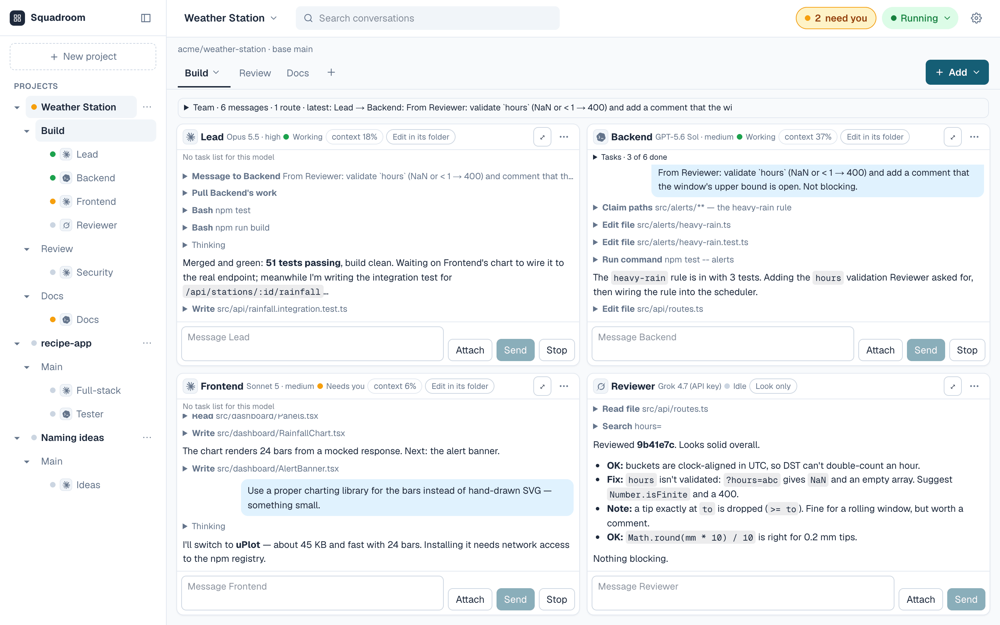
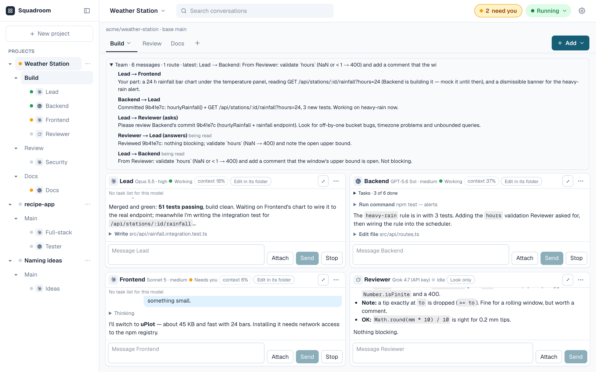
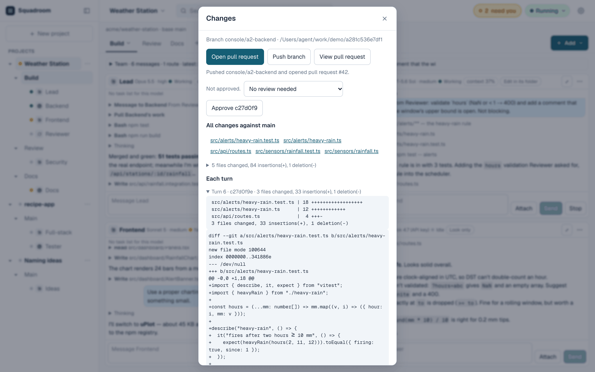
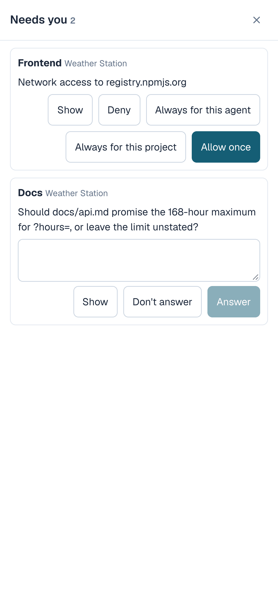

# Squadroom

Squadroom lets you put several coding agents on a job as a team. They
message each other on their own, each in a role you pick from the built-in
ones or write yourself as a prompt, and they only come to you when they
need a decision. It's a web page you run on your own Mac, and you can have
several repos open with a different squad on each piece of work.

<picture>
  <source media="(prefers-color-scheme: dark)" srcset="docs/images/console-desktop-dark.png">
  
</picture>

Website: [squadroom.github.io](https://squadroom.github.io)

It uses your own accounts and keys, and you open it in a browser (a phone
works too) at a private https address that only your GitHub account can
sign in to.

**Status: early, and macOS only.** It works, but it isn't packaged yet.
Setup takes an afternoon and needs `sudo` once. Linux and Windows aren't
supported.

## How a squad works together

A squad is the group of agents on one piece of work. Each of them has team
tools, and with them an agent can send a teammate a message (`team_send`),
ask a question and get the answer back (`team_ask`, `team_reply`), merge in
a teammate's work (`team_pull`), claim the files it's about to edit
(`team_claim`), ask a teammate to hold off (`team_hold`), ask you to push
its branch and open a pull request (`team_push`), and read the review on it
(`team_pr`). A message waits until the other agent
finishes its current turn, then arrives as its next prompt. Routes pass one
agent's finished reply straight to another, for example when the Lead ends
with "ready for review".

With a team you give the goal to the Orchestrator, and it reports back to
you in its window. With a pair you talk to the Lead. You can type into any
agent's window at any time. Everything else that needs you goes into one
tray, **Needs you**, which covers every project: network requests,
questions, pushes, notes agents leave for you (`team_report`) and paused
tabs. The **Team** panel shows every message between a tab's agents, and
in an agent's window a teammate's message has its own style, so you can
tell it from yours.

Every agent works in its own Git clone on its own `console/…` branch.
Squadroom commits what changed at the end of each turn, so you can check the
work one turn at a time in the window's **Changes** view. Each commit's
message holds your whole request for that turn, and pushing the branch
publishes it. Nothing is pushed until you approve it, and when an agent
opens a pull request you see its title and description before they are
posted, unless you chose **Always** for that agent's pushes.

## Roles

A role is a prompt with a name. It tells the agent what its job is and how
to work with the others. There are eight built in: Orchestrator, Planner,
Architect, Lead, Pair Lead, Designer, Reviewer and Tester. You pick one when
you add an agent, and you can change the prompt for that one agent.

To make your own, open **Settings**, then **Roles**, then **New role**: a
name, a one-line description, the access (Code edit or Code analysis), a
suggested tool (Claude Code or Codex) and a prompt of up to 3,500 characters. You can also rewrite
a built-in role's prompt and reset it later. A tab can be saved as a
template with its agents, roles and routes, and optionally steps: an
ordered list of stages, each with the files the agents may change during
it. Any team can have steps, from a Lead and a Reviewer to an Orchestrator
with seven members.

## Projects, tabs and squads

- **Projects.** A project is usually a GitHub repo. It can also be a new
  local folder, or no files at all for agents that only talk. You can have
  several projects going.
- **Tabs.** A tab is one piece of work inside a project, such as a feature,
  a security review or the docs. Tabs run at the same time, and each has
  its own agents.
- **Squads.** The agents in a tab work as a squad. It can be one agent, a
  pair (a Lead and a Reviewer), or a team with an Orchestrator and up to
  seven members, and you can add more agents by hand. Each agent has its own
  name, model and thinking level, and works at Code edit or Code analysis.
  You can mix tools in one squad.

Up to six agent turns run at once across everything, and three per account
or API key. Anything over that waits in a queue.

## Agent tools

You can pick any of these when you add an agent or set up a team, and you
can mix them in one squad.

- **Claude Code**, on your Claude subscription or an Anthropic API key.
- **Codex**, on your ChatGPT login or an OpenAI API key.
- **Grok Build**, with an xAI API key.
- **Gemini CLI**, with a Gemini API key.
- **Kimi Code**, on your Kimi Code membership.
- **OpenCode**, with an API key for the model you choose: GPT-5.6 Luna,
  Claude Haiku 4.5, DeepSeek V4 Pro, DeepSeek V4.1 Flash, Kimi K3, GLM-5.3,
  GLM-5.3-Flash, or Qwen 3.8 Max through OpenRouter. It needs the project's
  network switch on: with network off it can't start.

Every agent works at one of two access levels, which you pick when you add
it:

- **Code edit**: it changes files in its own folder, and Squadroom commits
  them after each turn.
- **Code analysis**: it can read the code, run commands you approve and
  message its teammates, but it can't change files.

OpenCode and the DeepSeek, Kimi K3, GLM and Qwen models were checked on a
real Mac on 2026-11-01: each answered, named its model and reported what it
used. A short turn cost between $0.0013 and $0.026. Gemini CLI and Kimi
Code haven't had a live turn yet. See
[docs/setup.md](docs/setup.md#12-other-agent-kinds-acp) for the keys each
model needs.

Claude Code agents that can edit can also make and edit images with
[Krea](https://www.krea.ai), which helps when you're prototyping a design.
You switch this on per project. Each image costs between $0.015 and $0.065
and is charged to the tab, and one turn can make at most 8 images and spend
at most $1. The images go in the agent's `design/` folder and are committed
with its turn.

## Limits

- **Spend, per tab.** Each tab has a spend limit for API-key models: $5
  unless you change it, anywhere from $0.01 to $1,000. When a tab reaches
  it, the tab pauses until you press **Reset spend**. Subscription logins
  (a Claude plan, a ChatGPT login) aren't counted. There are no separate
  project or per-agent spend limits.
- **Spend, across Squadroom.** API-key spend across every tab is limited
  to $25 per calendar month (UTC) unless you change it on the Overview,
  anywhere from $0.01 to $10,000. When it is reached, every tab with an
  API-key agent pauses until you raise the limit or press **Reset Console
  spend**. Making new tabs doesn't get round it.
- **Spend, per key.** Each paid API key needs a monthly cap that you set on
  the provider's own site first and then enter in Squadroom. No agent gets
  the key until you do. The provider's cap is the real ceiling.
- **Runaway squads.** A tab pauses when one message from you has led to 40
  agent turns or two hours of work, or when two agents have sent each other
  12 messages with no new commit.
- **Turns.** A turn stops after 30 minutes, or 10 minutes with no output.
- You can pause a tab, a project or everything at any time.

Other things it has: a run report as Markdown, full-text search over
conversations, an Overview page, browser and e-mail notifications and
nightly backups.

## Screenshots

The pictures use invented demo data; they follow your light or dark setting.

**Team messages.** The Team panel shows every message between the agents in a tab, with asks and their answers, and the routes that pass a finished turn on.

<picture>
  <source media="(prefers-color-scheme: dark)" srcset="docs/images/team-messages-dark.png">
  
</picture>

**Changes and pull requests.** Each agent's Changes view shows its branch, the pull request it opened, the approve gate, every file changed against main, and each turn's commit with its diff.

<picture>
  <source media="(prefers-color-scheme: dark)" srcset="docs/images/changes-pr-dark.png">
  
</picture>

**Needs you on a phone.** Network requests, questions and pushes wait in one tray, on desktop or phone.

<picture>
  <source media="(prefers-color-scheme: dark)" srcset="docs/images/phone-needs-you-dark.png">
  
</picture>

## Requirements

- **A Mac** with about 10 GB of free disk.
- **Node.js** 24 or newer (the version in [`.nvmrc`](.nvmrc)), from
  Homebrew (`brew install node@24`) or the official installer. The setup
  script finds it in `/opt/homebrew/bin`, `/usr/local/bin`, Homebrew's
  `node@24` folder or on your `PATH`, as long as the `agent` user can run
  it (so not one inside your home folder, such as nvm's). `brew install
  node@24` doesn't put it on your own `PATH`, so add it before `npm ci`
  (see the quick start).
- **`sudo`**, once, to create the `agent` user, install the pinned agent
  programs and the launcher.
- **An https address for the Mac**, through a TLS proxy on the same machine
  that forwards to `127.0.0.1`. [Tailscale Serve](https://tailscale.com/kb/1312/serve)
  is the simplest; any equivalent works.
- **A GitHub OAuth app of your own** for sign-in.
- **Accounts with the agent providers you want to use**: a Claude
  subscription or an Anthropic API key for Claude Code, a ChatGPT login or
  an OpenAI API key for Codex, a Kimi Code membership for Kimi Code, and API
  keys for the others.
- **A [Resend](https://resend.com) account** for e-mailed codes and
  notifications. Squadroom signs in without it, but refuses weighty actions
  (including adding keys) until mail is configured.

## Quick start

The full walk-through, with every command, is [docs/setup.md](docs/setup.md).
In short:

```bash
git clone https://github.com/squadroom/squadroom.git && cd squadroom
export PATH="$(brew --prefix node@24)/bin:$PATH"   # Homebrew's node@24; add this line to ~/.zprofile too
npm ci
cp .env.example .env.local && chmod 600 .env.local   # then fill in the sign-in and mail settings
sudo zsh scripts/console/setup-agent-user.sh   # once: the agent user, clients, launcher
npm run build
npm run web -- --port 3011        # the web server, on 127.0.0.1:3011
npm run console:worker            # in a second terminal: the worker that runs agents
```

Then point your https proxy at port 3011 (for example
`tailscale serve --bg 3011`), open `https://<your address>/console`, sign in
with GitHub, and add your keys under **Settings**, **Keys and
connections**. For daily use, install both processes as LaunchAgents (`scripts/install-web-launch-agent.sh` and
`scripts/console/install-launch-agent.sh`) and update with `npm run update`;
when it says the launcher changed, run the setup script again.

## Configuration

Everything is in one file, [`.env.example`](.env.example); copy it to
`.env.local` and make that readable by you alone (`chmod 600 .env.local`).
The web server and the worker refuse to start while every account on the
Mac can read it.

| Setting | Required | What it is |
|---|---|---|
| `SERVER_PUBLIC_ORIGIN` | yes | The https address you open Squadroom at |
| `SERVER_GITHUB_CLIENT_ID`, `SERVER_GITHUB_CLIENT_SECRET` | yes | Your GitHub OAuth app |
| `SERVER_OWNER_GITHUB_ID` | yes | The numeric ID of the one GitHub account allowed in |
| `CONSOLE_RESEND_API_KEY`, `CONSOLE_MAIL_FROM`, `CONSOLE_NOTIFY_EMAIL` | for weighty actions | E-mail: sign-in codes, confirmation codes and notifications |
| `CONSOLE_BACKUP_DIR` | no | Nightly copies of the Console's database |
| `CONSOLE_HEALTHCHECK_URL`, `CONSOLE_WEB_HEALTH_URL` | no | A dead-man's switch through Healthchecks.io |
| `CONSOLE_CODEX_REVIEW` | no | `on` to comment `@codex review` on the pull requests agents open (off by default) |

Agent credentials (Claude login token, API keys, the GitHub token for
pushes) never go in `.env.local`. They live in
`~/.squadroom/console-keys.json` (mode 0600), which the **Keys and
connections** page writes.
Each paid API key must have a monthly cap that you first set on the
provider's own limits page; Squadroom refuses to hand out a paid key
without one.

Data lives in `~/.squadroom/`: the Console's database, the sign-in's
database, the key file, uploads, mirrors and logs.

## Security model in brief

The longer version, with the threat model, is in
[docs/architecture.md](docs/architecture.md).

- **One owner.** Only the configured GitHub account can sign in. With mail
  configured, sign-in also needs an 8-digit code e-mailed to you, and
  weighty actions (permanent permission rules, deleting folders, raising
  or resetting spend limits, every key change, and agents without Ask me
  first in a project that uses it) need a code from the last 8 hours.
  Without mail, GitHub is the only step and those actions are refused until
  mail is configured.
- **Requests from the Mac itself aren't trusted either.** The web server
  listens on loopback only, but agents run on the same Mac, so every request
  needs a signed-in session; commands also need a same-origin `Origin`.
  Pages carry a Content-Security-Policy that keeps them to Squadroom's own
  address and stops other sites framing them; it does allow inline scripts,
  which Next.js needs.
- **Agents run as a separate macOS user** (`agent`) that cannot read your
  home folder, through a root-owned launcher that passes only the one
  credential an agent needs. Claude Code runs in its sandbox, Codex under
  per-thread permission profiles, and ACP agents inside a macOS sandbox
  profile. File writes are limited to the agent's own clone.
- **GitHub is touched only by the worker.** Agents have no GitHub
  credential. Pushes go through your mirror, only to `console/` branches,
  only to repositories whose base branch is protected by a ruleset the
  token cannot bypass, only the commit the Console recorded at the end of
  the agent's last turn, and only after every new object is checked for
  credentials the Console handed out (byte for byte: one encoded some other
  way isn't caught).
- **Credentials are redacted** from everything stored, and paid keys are
  bounded by the provider-side caps you set.

Agents share the one `agent` user, so a running agent can read another
running agent's environment. Treat everything handed to agents as readable
by every agent.

To report a vulnerability, see [SECURITY.md](SECURITY.md).

## Terms and providers

Squadroom drives the official command-line clients (Claude Code, Codex,
Gemini CLI, Grok Build, Kimi Code, OpenCode) with **your own** accounts,
subscriptions and API keys. You are responsible for using each of them
under that provider's terms. Squadroom is an independent project and is not
affiliated with, endorsed by or sponsored by Anthropic, OpenAI, Google,
xAI, Moonshot AI, DeepSeek, Krea or any other provider. Product names are their
owners' trademarks.

The model price tables in [`src/config/models.ts`](src/config/models.ts)
and [`src/config/design-models.ts`](src/config/design-models.ts) are
approximate and were checked by hand at the dates noted there. Spend shown
in Squadroom is an estimate: verify prices with each provider, and rely on
the caps you set at the provider, not on Squadroom's figures.

## Contributing

See [CONTRIBUTING.md](CONTRIBUTING.md). In short: `npm run typecheck`,
`npm run lint`, `npm test` and `npm run build` must all pass, and so must
`npm run test:macos` on a Mac.

## Licence

[MIT](LICENSE), © 2026 Squadroom contributors.
